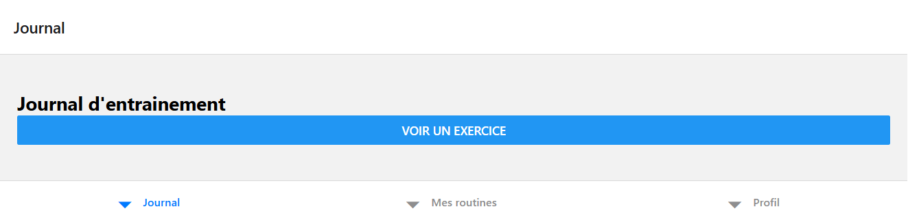
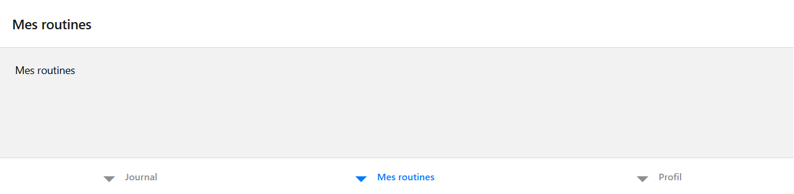
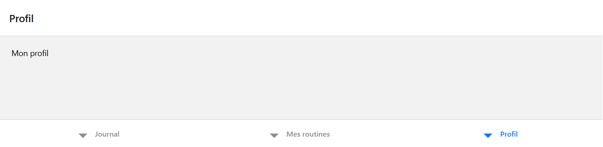
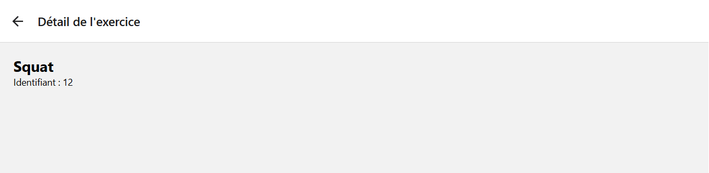
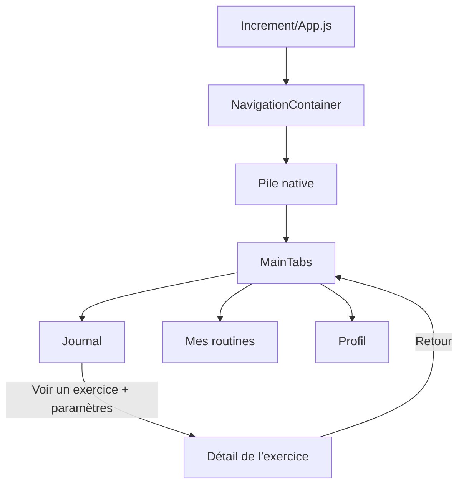

<div align="center">

# 🏋️ Increment

### Application mobile de démonstration — React Native & React Navigation

Un exemple clair de navigation par onglets et par pile, avec transmission de paramètres entre écrans.

<p>
  
  
  
  
</p>
<p>
  
  
  
</p>

</div>

---

## 📌 Sommaire

- [Présentation](#-présentation)
- [Fonctionnalités](#-fonctionnalités)
- [Captures d’écran](#-captures-décran)
- [Prérequis](#-prérequis)
- [Installation de A à Z](#-installation-de-a-à-z)
- [Lancer sur PC](#-lancer-sur-pc)
- [Lancer sur un téléphone](#-lancer-sur-un-téléphone)
- [Architecture et navigation](#-architecture-et-navigation)
- [Vérification du projet](#-vérification-du-projet)
- [Dépannage](#-dépannage)

## 🎯 Présentation

**Increment** est une petite application de suivi d’entraînement réalisée avec React Native et Expo. Elle sert de démonstration pratique de **React Navigation** : un navigateur inférieur permet de passer entre trois sections, et un navigateur en pile ouvre l’écran de détail d’un exercice.

Le projet Expo se trouve dans le dossier `Increment/`. Les écrans et le navigateur d’onglets se trouvent à la racine du dépôt ; la configuration Metro les rend accessibles au projet Expo.

## ✨ Fonctionnalités

| Écran | Description |
|---|---|
| **Journal** | Affiche le journal d’entraînement et un bouton pour ouvrir l’exercice « Squat ». |
| **Mes routines** | Présente l’onglet des routines. |
| **Profil** | Présente l’onglet du profil. |
| **Détail de l’exercice** | Affiche le nom et l’identifiant reçus depuis le journal, avec un bouton de retour. |

## 🖼️ Captures d’écran

Ces captures montrent les écrans réellement exécutés dans le navigateur. Les mêmes composants React Native sont utilisés par les cibles mobile et web.

<table>
  <tr>
    <td align="center"><strong>1. Journal</strong><br></td>
    <td align="center"><strong>2. Mes routines</strong><br></td>
  </tr>
  <tr>
    <td align="center"><strong>3. Profil</strong><br></td>
    <td align="center"><strong>4. Détail de l’exercice</strong><br></td>
  </tr>
</table>

## 🧰 Prérequis

Installez les outils suivants :

- **Node.js** (version LTS recommandée) et **npm** ;
- **Git**, si vous clonez le dépôt ;
- un navigateur récent pour lancer la version PC ;
- **Expo Go** sur votre iPhone ou appareil Android pour tester sur un téléphone.

> **Important :** les commandes npm doivent être lancées depuis `Increment/`, car c’est là que se trouvent `package.json` et `package-lock.json`.

## 🚀 Installation de A à Z

### 1. Récupérer le projet

Clonez le dépôt, ou ouvrez le dossier du projet déjà présent sur votre PC :

```powershell
git clone https://github.com/Lagmouchyoussef/react-native-navigation-architecture.git
cd .\react-native-navigation-architecture
```

### 2. Entrer dans le projet Expo

Depuis la racine du dépôt :

```powershell
cd .\Increment
```

### 3. Installer les dépendances

```powershell
npm ci
```

`npm ci` installe les versions enregistrées dans `package-lock.json`. Pour contrôler leur compatibilité avec Expo :

```powershell
npx expo install --check
```

## 💻 Lancer sur PC

Depuis `Increment/`, démarrez la version web :

```powershell
npm run web
```

Expo affiche l’adresse locale à ouvrir dans le navigateur, généralement `http://localhost:8081`. Si le port est déjà utilisé, choisissez-en un autre :

```powershell
npx expo start --web --port 8082
```

Ouvrez ensuite l’adresse indiquée dans le terminal. **`localhost` désigne le PC lui-même** : cette adresse ne doit pas être utilisée depuis un téléphone.

## 📱 Lancer sur un téléphone

### iPhone ou Android avec Expo Go

1. Installez ou mettez à jour **Expo Go** depuis l’App Store ou Google Play.
2. Dans `Increment/`, lancez Expo :

   ```powershell
   npm start
   ```

3. Attendez l’affichage du QR code dans le terminal ou dans la page Expo.
4. Scannez-le avec l’application **Expo Go**.
5. Gardez le serveur Expo ouvert pendant l’utilisation de l’application.

En mode réseau local, le PC et le téléphone doivent être connectés au même Wi-Fi. Si le réseau bloque cette connexion, essayez le tunnel Expo :

```powershell
npx expo start --tunnel
```

Scannez ensuite le nouveau QR code. Le tunnel nécessite une connexion Internet et peut être indisponible sur certains réseaux.

### Limite iOS sous Windows

Windows ne peut pas lancer le simulateur iOS de Xcode ni compiler localement une application iOS native. Pour tester sur iPhone, utilisez **Expo Go**. Le simulateur iOS et les compilations locales demandent macOS et Xcode.

### Android

Pour ouvrir l’application sur un émulateur Android configuré avec Android Studio :

```powershell
npm run android
```

Vous pouvez aussi scanner le QR code avec Expo Go sur un appareil Android.

## 🧭 Architecture et navigation



Depuis le journal, l’application transmet les paramètres de l’exercice à la route `DetailsExercice` :

```js
navigation.navigate('DetailsExercice', {
  exerciceId: 12,
  nom: 'Squat',
});
```

L’écran de détail lit ces paramètres dans `route.params` et affiche leur valeur. Il prévoit également une valeur de remplacement si un paramètre n’est pas fourni.

### Fichiers principaux

| Chemin | Rôle |
|---|---|
| `Increment/App.js` | Point d’entrée ; configure la zone de sécurité, la barre d’état et le navigateur en pile. |
| `Increment/index.js` | Enregistre le composant racine auprès d’Expo. |
| `Increment/app.json` | Nom, orientation, icône et paramètres de l’application Expo. |
| `Increment/metro.config.js` | Permet à Metro de surveiller les dossiers source situés à la racine du dépôt. |
| `Increment/package.json` | Dépendances et commandes npm. |
| `navigation/MainTabs.js` | Déclare les onglets Journal, Mes routines et Profil. |
| `screens/JournalScreen.js` | Écran d’accueil et navigation vers l’exercice. |
| `screens/RoutinesScreen.js` | Écran Mes routines. |
| `screens/ProfilScreen.js` | Écran Profil. |
| `screens/DetailsExerciceScreen.js` | Écran de détail et lecture des paramètres de route. |
| `docs/images/` | Captures d’écran intégrées à ce README. |

## ✅ Vérification du projet

Depuis `Increment/`, les commandes suivantes contrôlent les dépendances et génèrent les bundles web et iOS :

```powershell
npx expo install --check
npx expo export --platform web
npx expo export --platform ios
```

> L’export iOS vérifie le bundle JavaScript destiné à iOS ; ce n’est pas une compilation native Xcode.

## 🛠️ Dépannage

| Problème | Solution |
|---|---|
| `package.json` introuvable | Placez-vous dans le dossier du dépôt, puis exécutez `cd .\Increment`. |
| Le port Expo est déjà utilisé | Utilisez un autre port, par exemple `npx expo start --web --port 8082`. |
| Le téléphone n’arrive pas à joindre le serveur | N’utilisez pas `localhost` sur le téléphone. Essayez le même Wi-Fi, puis `npx expo start --tunnel`. |
| Expo Go indique une incompatibilité | Mettez Expo Go à jour, redémarrez Expo et contrôlez les dépendances avec `npx expo install --check`. |
| Un module est introuvable | Vérifiez que vous êtes dans `Increment/`, puis relancez `npm ci`. |
| Le simulateur iOS ne démarre pas sous Windows | C’est attendu : utilisez Expo Go sur iPhone ou un Mac avec Xcode. |
| Le tunnel se déconnecte | Vérifiez la connexion Internet, relancez `npx expo start --tunnel` et scannez le QR code actualisé. |

## 📦 Technologies

- **JavaScript** — langage de l’application ;
- **React Native** — composants d’interface multiplateforme ;
- **Expo** — démarrage et export de l’application ;
- **React Navigation** — navigation en onglets et en pile ;
- **React Native Web** — exécution dans un navigateur ;
- **Safe Area Context** et **Expo Status Bar** — intégration de l’interface aux écrans mobiles.

---

<div align="center">
  Réalisé dans le cadre du TP React Navigation · <strong>Increment</strong>
</div>
