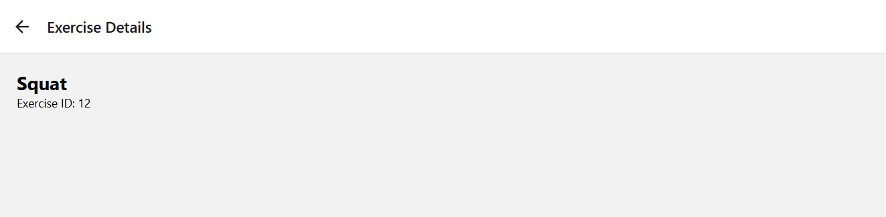
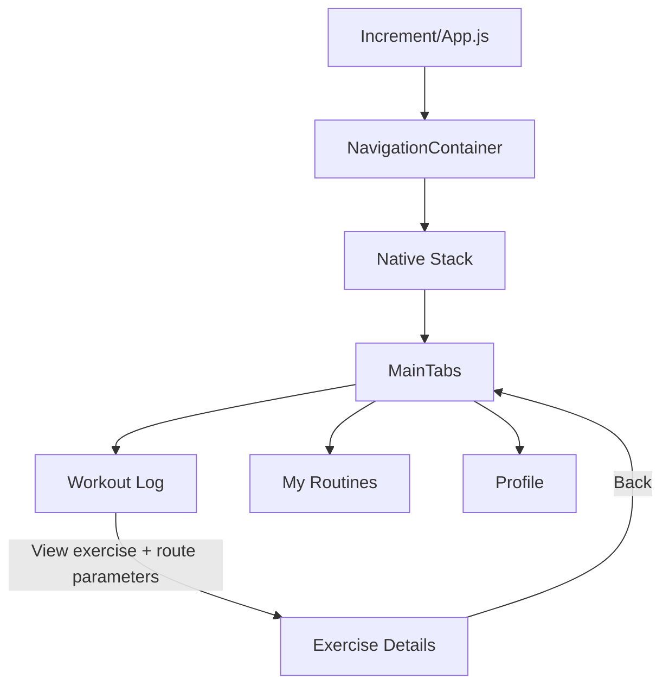

<div align="center">

<h1>🏋️ Increment</h1>

<p><strong>A cross-platform React Native navigation demo</strong></p>
<p>Explore bottom-tab navigation, a native stack, and route-parameter passing in one compact app.</p>

<p>
  
  
  
  
</p>
<p>
  
  
  
</p>

</div>

---

## 📚 Table of Contents

- [Overview](#-overview)
- [Features](#-features)
- [Application Screenshots](#-application-screenshots)
- [Technology Stack](#-technology-stack)
- [Prerequisites](#-prerequisites)
- [Build the Project from Scratch](#-build-the-project-from-scratch)
- [Run the Existing Repository](#-run-the-existing-repository)
- [Run on the Web](#-run-on-the-web)
- [Run on a Mobile Device](#-run-on-a-mobile-device)
- [Project Structure](#-project-structure)
- [Navigation Flow](#-navigation-flow)
- [Validation](#-validation)
- [Troubleshooting](#-troubleshooting)

## 🎯 Overview

**Increment** is a small workout-tracking app built with React Native and Expo. It demonstrates a practical React Navigation setup: a bottom tab navigator switches between the main sections, while a native stack navigator opens an exercise detail screen and passes route parameters.

The Expo application lives in `Increment/`. Application screens and tab navigation are stored at the repository root and are included in Metro's watch folders.

## ✨ Features

| Screen | Purpose |
|---|---|
| **Workout Log** | Displays the workout log and opens the sample Squat exercise. |
| **My Routines** | Demonstrates the routines tab. |
| **Profile** | Demonstrates the profile tab. |
| **Exercise Details** | Displays the exercise name and ID passed from the workout log. |

## 🖼️ Application Screenshots

The screenshots below are captured from the running web build. The same React Native screens are shared with the mobile targets.

<table>
  <tr>
    <td align="center"><strong>1. Workout Log</strong><br></td>
    <td align="center"><strong>2. My Routines</strong><br></td>
  </tr>
  <tr>
    <td align="center"><strong>3. Profile</strong><br></td>
    <td align="center"><strong>4. Exercise Details</strong><br></td>
  </tr>
</table>

## 🧩 Technology Stack

| Technology | Role |
|---|---|
| [JavaScript](https://developer.mozilla.org/en-US/docs/Web/JavaScript) | Application language |
| [React Native](https://reactnative.dev/) | Cross-platform user interface |
| [Expo](https://expo.dev/) | Development server and app tooling |
| [React Navigation](https://reactnavigation.org/) | Bottom tabs and native stack |
| [React Native Web](https://necolas.github.io/react-native-web/) | Web platform support |
| [Safe Area Context](https://github.com/th3rdwave/react-native-safe-area-context) | Safe-area handling on mobile |
| [Expo Status Bar](https://docs.expo.dev/versions/latest/sdk/status-bar/) | Status bar configuration |

## 🧰 Prerequisites

Install the following before starting:

- **Node.js** (the current LTS release is recommended) and **npm**;
- **Git**, if you plan to clone the repository;
- a modern browser for the web build;
- **Expo Go** on an iPhone or Android device for on-device testing.

> **Important:** run all npm and Expo commands from `Increment/`, where `package.json` and `package-lock.json` are located.

## 🧑‍🎓 Build the Project from Scratch

This section is for a beginner starting with an empty folder. Follow the steps in order. You will create the Expo app, install navigation dependencies, add the screen files, and run the completed app.

### Step 1: Install the tools

Install **Node.js LTS** from [nodejs.org](https://nodejs.org/), then open a new PowerShell terminal and verify the installation:

```powershell
node --version
npm --version
```

Install **Visual Studio Code** and the **Expo Go** app on your phone. Git is optional for this from-scratch path.

### Step 2: Create the workspace and Expo app

In PowerShell, choose a location for your projects and run:

```powershell
mkdir react-native-navigation-architecture
cd .\react-native-navigation-architecture
npx create-expo-app@latest Increment --template blank
code .
```

If `code .` is not recognized, open Visual Studio Code and select **File > Open Folder**, then choose the `react-native-navigation-architecture` folder. The `Increment` folder is the Expo application root.

### Step 3: Install the libraries

Open the integrated terminal in Visual Studio Code. Change to `Increment/` and install the Expo-compatible versions of React Navigation and its native dependencies:

```powershell
cd .\Increment
npx expo install @react-navigation/native @react-navigation/bottom-tabs @react-navigation/native-stack react-native-safe-area-context react-native-screens react-native-gesture-handler react-native-reanimated react-native-worklets expo-status-bar expo-asset react-dom react-native-web
```

The Expo template already provides React and React Native. The command also installs the status-bar package, Expo asset support, and the React Native Web packages.

### Step 4: Create the source folders

Return to the workspace root and create the application source folders:

```powershell
cd ..
New-Item -ItemType Directory -Force .\navigation, .\screens | Out-Null
```

Your folder structure should now include:

```text
react-native-navigation-architecture/
├── Increment/
├── navigation/
└── screens/
```

### Step 5: Configure Metro for the workspace

The screens and navigation folder are siblings of `Increment/`, rather than children of it. Create or replace `Increment/metro.config.js` with:

```js
const path = require('node:path');
const { getDefaultConfig } = require('expo/metro-config');

const projectRoot = __dirname;
const workspaceRoot = path.resolve(projectRoot, '..');
const config = getDefaultConfig(projectRoot);

config.watchFolders = [workspaceRoot];
config.resolver.nodeModulesPaths = [path.resolve(projectRoot, 'node_modules')];
config.resolver.disableHierarchicalLookup = true;

module.exports = config;
```

This tells Metro to watch the workspace source folders and resolve packages from the Expo project's `node_modules`.

When a step below says **Create** a file, use the Visual Studio Code Explorer: right-click the named folder, select **New File**, enter the exact path and filename, paste the code, and save with `Ctrl+S`. Among the files added or replaced in this guide, `App.js` and `metro.config.js` belong inside `Increment/`; the screen and navigation files belong in the repository-root folders.

### Step 6: Create the tab navigator

Create `navigation/MainTabs.js`:

```js
import React from 'react';
import { createBottomTabNavigator } from '@react-navigation/bottom-tabs';
import WorkoutLogScreen from '../screens/WorkoutLogScreen';
import RoutinesScreen from '../screens/RoutinesScreen';
import ProfileScreen from '../screens/ProfileScreen';

const Tab = createBottomTabNavigator();

export default function MainTabs() {
  return (
    <Tab.Navigator>
      <Tab.Screen
        name="WorkoutLog"
        component={WorkoutLogScreen}
        options={{ title: 'Workout Log' }}
      />
      <Tab.Screen
        name="Routines"
        component={RoutinesScreen}
        options={{ title: 'My Routines' }}
      />
      <Tab.Screen name="Profile" component={ProfileScreen} />
    </Tab.Navigator>
  );
}
```

### Step 7: Create the screens

Create `screens/WorkoutLogScreen.js`. This screen opens the exercise route and passes two parameters:

```js
import React from 'react';
import { View, Text, Button } from 'react-native';

export default function WorkoutLogScreen({ navigation }) {
  return (
    <View style={{ flex: 1, padding: 20, justifyContent: 'center' }}>
      <Text style={{ fontSize: 22, fontWeight: 'bold' }}>Workout Log</Text>
      <Button
        title="View exercise"
        onPress={() =>
          navigation.navigate('ExerciseDetails', {
            exerciseId: 12,
            exerciseName: 'Squat',
          })
        }
      />
    </View>
  );
}
```

Create `screens/RoutinesScreen.js`:

```js
import React from 'react';
import { View, Text } from 'react-native';

export default function RoutinesScreen() {
  return (
    <View style={{ flex: 1, padding: 20 }}>
      <Text>My routines</Text>
    </View>
  );
}
```

Create `screens/ProfileScreen.js`:

```js
import React from 'react';
import { View, Text } from 'react-native';

export default function ProfileScreen() {
  return (
    <View style={{ flex: 1, padding: 20 }}>
      <Text>My profile</Text>
    </View>
  );
}
```

Create `screens/ExerciseDetailsScreen.js`. It reads the values passed by the Workout Log screen:

```js
import React from 'react';
import { View, Text } from 'react-native';

export default function ExerciseDetailsScreen({ route }) {
  const exerciseId = route.params?.exerciseId;
  const exerciseName = route.params?.exerciseName ?? 'Unnamed exercise';

  return (
    <View style={{ flex: 1, padding: 20 }}>
      <Text style={{ fontSize: 22, fontWeight: 'bold' }}>{exerciseName}</Text>
      <Text>Exercise ID: {exerciseId ?? 'Not provided'}</Text>
    </View>
  );
}
```

### Step 8: Connect the screens in the root app

Replace the contents of `Increment/App.js` with:

```js
import React from 'react';
import { NavigationContainer } from '@react-navigation/native';
import { createNativeStackNavigator } from '@react-navigation/native-stack';
import { StatusBar } from 'expo-status-bar';
import { SafeAreaProvider } from 'react-native-safe-area-context';
import ExerciseDetailsScreen from '../screens/ExerciseDetailsScreen';
import MainTabs from '../navigation/MainTabs';

const Stack = createNativeStackNavigator();

export default function App() {
  return (
    <SafeAreaProvider>
      <NavigationContainer>
        <StatusBar style="auto" />
        <Stack.Navigator>
          <Stack.Screen
            name="MainTabs"
            component={MainTabs}
            options={{ headerShown: false }}
          />
          <Stack.Screen
            name="ExerciseDetails"
            component={ExerciseDetailsScreen}
            options={{ title: 'Exercise Details' }}
          />
        </Stack.Navigator>
      </NavigationContainer>
    </SafeAreaProvider>
  );
}
```

The `NavigationContainer` must wrap the navigators. The stack registers `ExerciseDetails`, so the Workout Log button can open it.

### Step 9: Start and test the app

In the terminal, switch back to the Expo project and start the development server:

```powershell
cd .\Increment
npx expo install --check
npm start
```

Verify the following:

1. The **Workout Log**, **My Routines**, and **Profile** tabs are visible.
2. Select each tab and confirm its screen appears.
3. Return to **Workout Log** and select **View exercise**.
4. Confirm that **Exercise Details** shows `Squat` and `Exercise ID: 12`.
5. Use the back button to return to the tabs.

Compare the result with the [application screenshots](#-application-screenshots).

Use the [web instructions](#-run-on-the-web) to test in a PC browser or the [mobile instructions](#-run-on-a-mobile-device) to test on a phone.

## 📥 Run the Existing Repository

Use this shorter path if you want to run the completed project instead of building it yourself.

### 1. Clone the repository

```powershell
git clone https://github.com/Lagmouchyoussef/react-native-navigation-architecture.git
cd .\react-native-navigation-architecture\Increment
```

### 2. Install the locked dependencies

```powershell
npm ci
npx expo install --check
```

Continue with [Run on the Web](#-run-on-the-web) or [Run on a Mobile Device](#-run-on-a-mobile-device).

## 🌐 Run on the Web

Start the web development server from `Increment/`:

```powershell
npm run web
```

Open the URL printed in the terminal. Expo commonly uses `http://localhost:8081`. If that port is already occupied, use another one:

```powershell
npx expo start --web --port 8082
```

`localhost` refers to the current computer. A phone cannot use the computer's `localhost` address.

## 📱 Run on a Mobile Device

### iPhone or Android with Expo Go

1. Install or update **Expo Go** from the App Store or Google Play.
2. From `Increment/`, start Expo:

   ```powershell
   npm start
   ```

3. Wait for the QR code in the terminal or Expo's development page.
4. Scan the QR code with Expo Go.
5. Keep the Expo server running while using the app.

For LAN mode, the computer and phone must be on the same Wi-Fi network. If the network blocks local device connections, start an Expo tunnel:

```powershell
npx expo start --tunnel
```

Scan the refreshed QR code. Tunnels require an active internet connection and may be restricted by some networks.

### iOS on Windows

Windows cannot run Apple's iOS Simulator or perform a local Xcode build. Use **Expo Go on an iPhone** to test from Windows. The iOS Simulator and local native builds require macOS and Xcode.

### Android Emulator

To launch on an Android emulator configured with Android Studio:

```powershell
npm run android
```

Expo Go on a physical Android device is also supported.

## 🗂️ Project Structure

```text
react-native-navigation-architecture/
├── Increment/
│   ├── App.js
│   ├── app.json
│   ├── index.js
│   ├── metro.config.js
│   └── package.json
├── navigation/
│   └── MainTabs.js
├── screens/
│   ├── ExerciseDetailsScreen.js
│   ├── ProfileScreen.js
│   ├── RoutinesScreen.js
│   └── WorkoutLogScreen.js
├── docs/
│   └── images/
└── README.md
```

### Key Files

| Path | Responsibility |
|---|---|
| `Increment/App.js` | Root providers and native stack routes |
| `Increment/index.js` | Registers the Expo root component |
| `Increment/app.json` | Expo app metadata, orientation, and assets |
| `Increment/metro.config.js` | Adds the repository source folders to Metro's watch list |
| `Increment/package.json` | Dependencies and npm scripts |
| `navigation/MainTabs.js` | Declares the Workout Log, My Routines, and Profile tabs |
| `screens/WorkoutLogScreen.js` | Workout log screen and exercise navigation action |
| `screens/RoutinesScreen.js` | My Routines screen |
| `screens/ProfileScreen.js` | Profile screen |
| `screens/ExerciseDetailsScreen.js` | Exercise details and route parameter rendering |
| `docs/images/` | README screenshots |

## 🧭 Navigation Flow



The workout log opens the detail route and passes an exercise ID and name:

```js
navigation.navigate('ExerciseDetails', {
  exerciseId: 12,
  exerciseName: 'Squat',
});
```

`ExerciseDetailsScreen` reads these values from `route.params` and provides fallback text when a value is missing.

## ✅ Validation

Run these checks from `Increment/`:

```powershell
npx expo install --check
npx expo export --platform web
npx expo export --platform ios
```

The iOS export validates the JavaScript bundle for iOS; it is **not** a native Xcode build.

## 🛠️ Troubleshooting

| Issue | Resolution |
|---|---|
| `package.json` cannot be found | Change to the repository root, then run `cd .\Increment`. |
| The Expo port is already in use | Select another port, for example `npx expo start --web --port 8082`. |
| The phone cannot reach the development server | Do not use `localhost` on the phone. Try the same Wi-Fi network, then `npx expo start --tunnel`. |
| Expo Go reports an SDK mismatch | Update Expo Go, restart the server, and run `npx expo install --check`. |
| A module cannot be resolved | Confirm the terminal is in `Increment/`, then run `npm ci`. |
| The iOS Simulator will not start on Windows | This is expected. Use Expo Go on an iPhone or a Mac with Xcode. |
| The Expo tunnel disconnects | Check internet access, restart `npx expo start --tunnel`, and scan the new QR code. |

---

<div align="center">
  Built with React Native, Expo, and React Navigation.
</div>
